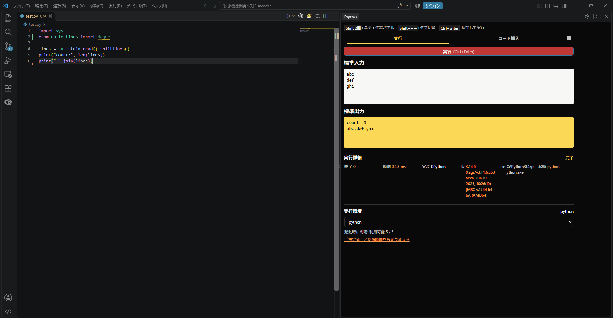

# Piyoyo

<p align="center">
  
</p>

<p align="center">
  <a href="https://github.com/latticebold/Piyoyo/releases/latest"></a>
  <a href="https://github.com/latticebold/Piyoyo/actions/workflows/test.yml"></a>
  <a href="LICENSE"></a>
</p>

Piyoyoは、競技プログラミングをPythonで始めた人のためのVS Code拡張機能です。
サイドバーのパネルに、次の3つのタブがあります。

- **実行**：保存したPythonファイルに標準入力を渡して実行し、出力、エラー（日本語の説明付き）、実行時間を確かめる。
- **コード挿入**：よく使う短いコードを日本語で探し、計算量を見て挿入する。必要なimportも自動で入る。
- **検証**：提出する前に、ランダムな入力で反例を探し（ストレステスト）、計算量から制限時間に間に合うかを見積もる。



## 名前の由来

Piyoyo（ピヨヨ）は、Pythonの入力と出力を試す「Python Input Output Tester」という役割から生まれた名前です。

Python I/Oを縮めた **PYIO** を出発点に、文字を並べ替えて **PIYO** に。
そこへ文字を加え、初心者にも親しみやすい響きの **Piyoyo** にしました。

Pythonや競技プログラミングを始めた人が、入力と出力を気軽に試せる道具を目指しています。

## できること

- 複数行の標準入力を渡して、開いているPythonファイルを実行する。
- Python、Python Launcher、PyPyなどから実行環境を選ぶ。
- 文字列、リスト、添字・スライス、集合などの短い操作を日本語で検索し、計算量を確認して挿入する。
- `deque`、`Counter`、`bisect`などの必要なimportを自動で追加する。
- ハミング距離などの自作関数は、呼び出しを挿入し、関数の定義をファイルの上の方へ1回だけ自動で追加する。
- Pythonの実行エラーを日本語で説明する。
- コード整理で、スニペットの表示と同じジャンル内の順番を自分用に変える。
- 「検証」タブで、問題の入力形式から入力を自動で作り、本番の解と愚直解の出力を比べて反例を探す（ストレステスト）。最大サイズの入力で時間切れや実行時エラーも探す（[検証タブ](docs/user-guide.md#検証タブで反例を探す)）。
- 書いたコードの計算量（`O(N²)`など）を見積もり、入力の上限から制限時間に間に合うか（余裕 / 厳しい / TLE の恐れ）を出す。入力のサイズを変えて実際の時間も測る（[計算量を見積もる](docs/user-guide.md#計算量を見積もる)）。
- キーボードだけで操作する。Pythonファイルで`Ctrl+Enter`（macOSは`Cmd+Enter`）を押すと、保存して実行する。`Alt+I`（macOSは`Option+I`）でエディタとPiyoyoパネル（最後に開いていたタブ）を行き来し、Piyoyoパネルの中では`Shift+←` / `Shift+→`で「実行」「コード挿入」「検証」タブを隣へ切り替える（文字の入力欄の中では、カーソルが端にあるときだけ切り替わる）。よく使うキーはパネルの上に常に表示される（[キーボード操作](docs/user-guide.md#キーボード操作)）。

## 必要なもの

- VS Code 1.90以降。
- Pythonが実行できる環境。PyPyが入っていれば、何も設定しなくてもPyPyで実行します（AtCoderでよく使われ、Pythonより速く動きます）。
- Windowsで動作を確認しています。

macOSとLinuxは未検証です。

## インストール

Piyoyoは、GitHub ReleasesからダウンロードしたVSIXファイルを、VS Codeにインストールして使えます。

1. [Releases](https://github.com/latticebold/Piyoyo/releases) から `piyoyo-*.vsix` をダウンロードします。
2. VS Codeで `Ctrl + Shift + X` を押し、拡張機能ビューを開きます。
3. ビュー上部の `...` から **Install from VSIX...（VSIXからのインストール）** を選びます。
4. ダウンロードしたVSIXファイルを選びます。
5. 再読み込みを求められた場合は、VS Codeを再読み込みします。

`Source code (zip)` や `Source code (tar.gz)` はソースコードのアーカイブです。
インストールには `.vsix` ファイルを使ってください。

最初の実行、Pythonの選び方、スニペットの使い方は[利用ガイド](docs/user-guide.md)を参照してください。
版ごとの変更点は[変更履歴](CHANGELOG.md)にまとめています。
配布担当者は[リリース手順](docs/releasing.md)を参照してください。

### インストール後のVSIXファイル

インストールが完了し、Piyoyoが動くことを確認したら、ダウンロードしたVSIXファイルは削除してかまいません。
拡張機能の本体はVS Code側に保存されるため、元のVSIXファイルを残しておく必要はありません。

### VS Codeの再読み込み

1. 編集中のファイルを保存します。
2. `Ctrl + Shift + P` を押し、コマンドパレットを開きます。
3. `Developer: Reload Window` と入力し、表示されたコマンドを実行します。

## 最短で試す

1. 保存済みの `.py` ファイルを開きます。
2. エディタ右上のPiyoyoアイコン、またはコマンドパレットの `Piyoyo: Open` でPiyoyoを開きます。
3. 「標準入力」にテストデータを入れ、「実行」を押します。
4. 「標準出力」と「実行詳細」を確認します。

実行するのはディスクへ保存されたファイルです。
未保存の変更を実行したい場合は、先に保存してください。
エディタで`Ctrl+Enter`を押すと、保存と実行をまとめて行えます。
この割り当ては、Pythonファイルで通常の「下に行を挿入」の代わりになります。変え方は[利用ガイド](docs/user-guide.md#ctrlenterの割り当てを変える)を参照してください。
標準出力と標準エラーは合計1 MiBまで保持します。
上限を超えた場合は実行を停止し、残りの出力を省略した理由を表示します。

## Piyoyoを開く・表示位置を変える

Pythonファイルを開き、エディタ右上のPiyoyoアイコンを押すと、実行パネルが開きます。
コマンドパレットから `Piyoyo: Open` を実行して開くこともできます。

### Piyoyoだけを右側に表示する

通常、Piyoyoは左側のサイドバーに表示されます。
ファイル一覧を左側に残し、Piyoyoを右側に表示したい場合は、次のように移動します。

1. **表示 → 外観 → セカンダリ サイド バー** を選び、反対側のサイドバーを表示します。
2. `Piyoyo Runner` の見出しを、セカンダリサイドバーへドラッグします。

左側に戻す場合は、見出しを元のサイドバーへドラッグします。

### サイドバー全体を左右に移動する

ファイル一覧なども含めて移動したい場合は、**表示 → 外観 → プライマリ サイド バーを右に移動** を選びます。
戻す場合は、左に移動する項目を選びます。
セカンダリサイドバーは、常にプライマリサイドバーの反対側に表示されます。

## 設定

Piyoyoパネル上部の歯車ボタン（または`Piyoyo Runner`の見出しの歯車アイコン）を押すと、Piyoyoの設定だけを表示した設定画面が開きます。
詳しくは[利用ガイド](docs/user-guide.md#設定を変える)の「設定を変える」を参照してください。

| 設定 | 初期値 | 内容 |
| --- | --- | --- |
| `piyoyo.pythonPath` | 空 | Python実行ファイルのパスです。実行環境で選んだ値を優先し、空の場合は起動できるPyPy（`pypy3`、`pypy`）、`python.defaultInterpreterPath`、OSの標準候補の順に使います。 |
| `piyoyo.timeoutMs` | `2000` | Pythonの最大実行時間をミリ秒で指定します。初期値はAtCoderのABCに合わせた2秒です。 |
| `piyoyo.showPyPyInstallHint` | `true` | PyPyが見つからずPythonで実行したときに、PyPyの入れ方の案内を出します。 |
| `piyoyo.complexity.showInlineHints` | `true` | 計算量の解析結果を、エディタのループの行と関数の行の右端に薄く表示します。 |
| `piyoyo.errorDisplayMode` | `friendly` | Pythonのエラーの表示方法です。`friendly`（やさしい表示）は日本語の説明を表示し、元のエラーは「原文を見る」に折りたたみます。`both`（両方表示）は両方を表示し、`original`（原文表示）は元のエラーとトレースバックを中心に表示します。 |
| `piyoyo.inputFocusShortcut` | `altI` | PythonのエディタとPiyoyoパネルを行き来するキーです。`altI`（`Alt+I`）、`shiftShift`（`Shift`を2回）、`both`（両方）から選びます。 |
| `piyoyo.advanced.showOriginalErrors` | `false` | 以前の設定です。`piyoyo.errorDisplayMode`を設定していない場合に限り、`true`で「両方表示」になります。 |

## 開発者向け

テストとJavaScriptの構文確認は次のコマンドで実行します。

```powershell
npm test
npm run check
```

テストにはPythonと[uv](https://docs.astral.sh/uv/)が必要です。
`main`へのpushとプルリクエストでは、GitHub Actionsが同じコマンドをWindows上で自動で実行します。結果はGitHubの「Actions」タブで確認できます。

開発のルールは[AGENTS.md](AGENTS.md)、配布の手順は[リリース手順](docs/releasing.md)にあります。
機能ごとの設計や仕様は次の文書にまとめています。

| 文書 | 内容 |
| --- | --- |
| [検証タブの設計](docs/verify-design.md) | ストレステストと入力の自動生成の仕組み |
| [計算量推定の設計](docs/complexity-design.md) | 静的解析と実測による計算量の見積もり |
| [Pythonエラーの日本語説明の仕様](docs/python-error-explanation-spec.md) | どのエラーをどう説明するか |
| [スニペットカタログ再設計案](docs/snippet-catalog-proposal.md) | 初期のスニペット整理の記録 |
| [0.2.0 リリース評価](docs/release-evaluation-2026-09-28.md) | 最初の公開前に行った評価の記録 |

## 参考にしたサービス

Piyoyoは、初心者向けのPython開発環境 [PyTry（パイトライ）](https://pro-ktmr.github.io/pytry/) の、入力と実行結果を分けて気軽に試せる体験に着想を得ています。
そのような環境をVS Codeでも使いたいと考え、AIエージェントと一緒に開発しました。

## 開発クレジット

この拡張機能は、Codex（OpenAIのGPTモデル）とClaude Code（AnthropicのClaudeモデル）を使ったVibe Codingで開発しました。

## ライセンス

Piyoyoは、GNU General Public License version 3.0（GPL-3.0-only）で提供します。

商用利用と販売を認めています。
改変版を配布する場合は、GPLの条件に従い、その版に対応するソースコードも提供してください。
Piyoyoのコードを他のプログラムに組み込んで一体として配布する場合は、その全体にもGPLの条件が適用されることがあります。

個人の手元で使ったり改変したりするだけで、ソースコードを公開する必要はありません。
詳しい条件は [LICENSE](LICENSE)、著作権表示は [COPYRIGHT](COPYRIGHT) を参照してください。
