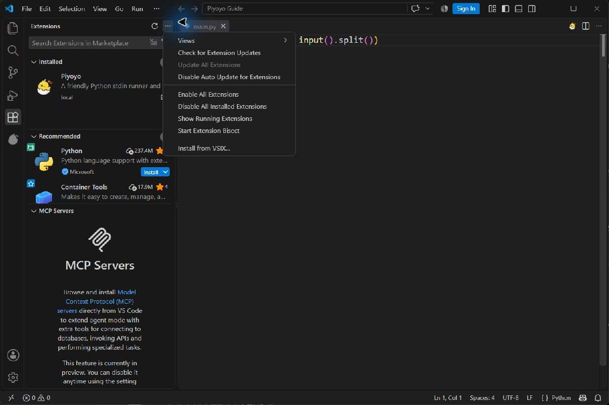
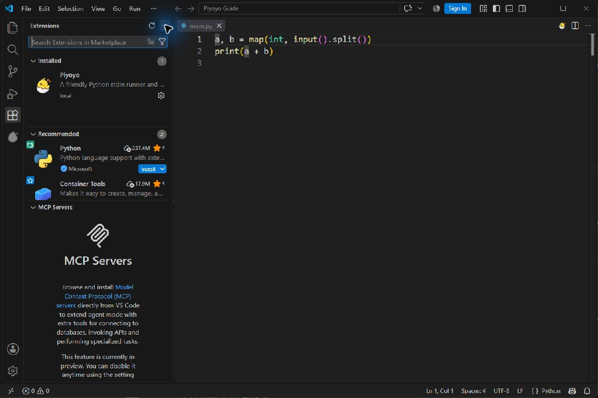
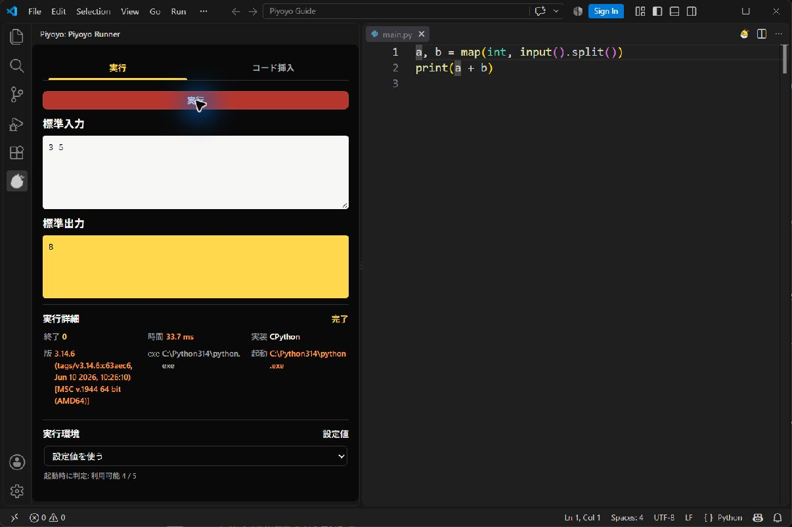
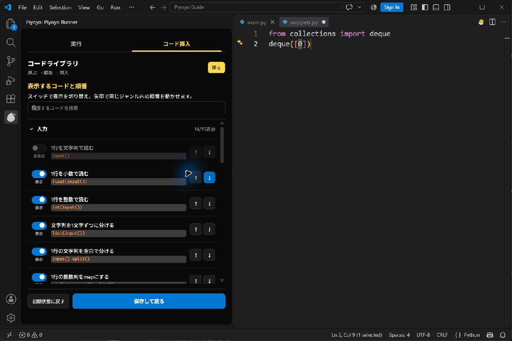

# Piyoyo 利用ガイド

Piyoyoは、保存済みのPythonファイルに標準入力を渡して実行し、競技プログラミング向けのコードを挿入するVS Code拡張機能です。
このガイドでは、VS CodeとPythonを導入済みのWindowsでの操作を説明します。
macOSとLinuxは未検証です。
macOSではコマンドパレットを`Cmd+Shift+P`で開き、LinuxとmacOSでは`python3`を選ぶ必要がある場合があります。

## VSIXをインストールする

Piyoyoは、GitHub ReleasesからダウンロードしたVSIXファイルを、VS Codeにインストールして使えます。

1. [Releases](https://github.com/latticebold/Piyoyo/releases)から`piyoyo-*.vsix`をダウンロードします。
2. VS Codeで`Ctrl+Shift+X`を押し、拡張機能ビューを開きます。
3. ビュー右上の`...`を選び、Install from VSIX...（VSIXからのインストール）を選びます。
4. ダウンロードしたVSIXファイルを選びます。
5. 表示された場合は「再読み込み」を選びます。



`Source code (zip)`や`Source code (tar.gz)`はソースコードのアーカイブです。
インストールには`.vsix`ファイルを使ってください。

インストール済みかどうかは、拡張機能ビューでPiyoyoを検索し、Installed（インストール済み）と表示されることを確認します。



VS CodeでのVSIXの扱いは、[VS Code公式の拡張機能ドキュメント](https://code.visualstudio.com/docs/configure/extensions/extension-marketplace)も参照してください。

### インストール後のVSIXファイル

インストールが完了し、Piyoyoが動くことを確認したら、ダウンロードしたVSIXファイルは削除してかまいません。
拡張機能の本体はVS Code側に保存されるため、元のVSIXファイルを残しておく必要はありません。

### VS Codeの再読み込みと表示位置

編集中のファイルを保存し、`Ctrl+Shift+P`でコマンドパレットを開いて`Developer: Reload Window`を実行します。
Piyoyoを左右のサイドバーへ移動する方法は、[README](../README.md)の「Piyoyoを開く・表示位置を変える」を参照してください。

## 最初のPython実行

`main.py`を作成して、次の2行を保存します。

```python
a, b = map(int, input().split())
print(a + b)
```

Piyoyoが実行するのは保存済みの内容です。
エディタの未保存変更は実行されないため、実行前に保存してください。

1. `main.py`をエディタで開きます。
2. エディタ右上のPiyoyoアイコンを選びます。
3. アイコンが見つからない場合は、コマンドパレットを開いて`Piyoyo: Open`を実行します。
4. Piyoyoの「実行」タブで「標準入力」に次の入力を入れます。

```text
3 5
```

5. 上部の「実行」を押します。
6. 「標準出力」に`8`が表示されることを確認します。

エディタで`Ctrl+Enter`（macOSは`Cmd+Enter`）を押すと、保存と実行をまとめて行えます（[キーボード操作](#キーボード操作)を参照）。



「実行詳細」には終了コード、実行時間、実際に使ったPython実装、バージョン、実行ファイルのパスが表示されます。
Pythonの実行エラーが起きた場合は、日本語の説明を表示します。
Pythonの元のエラーとトレースバック（原文）は、説明の下の「原文を見る」を開くと確認できます。
表示方法は設定`piyoyo.errorDisplayMode`で選べます（開き方は「[設定を変える](#設定を変える)」を参照）。

| 設定画面の表示 | 値 | 内容 |
| --- | --- | --- |
| やさしい表示（初期値） | `friendly` | 日本語の説明を表示し、原文は「原文を見る」に折りたたみます。 |
| 両方表示 | `both` | 日本語の説明と原文を両方表示します。 |
| 原文表示 | `original` | 原文を中心に表示し、日本語の説明は「日本語の説明を見る」に折りたたみます。 |

以前の設定`piyoyo.advanced.showOriginalErrors`を`true`にしている場合は、`piyoyo.errorDisplayMode`を設定するまで「両方表示」になります。
初期状態では、実行が2秒（AtCoderのABCの時間制限）を超えるとタイムアウトします。
標準出力と標準エラーは合計1 MiBまで保持します。
上限を超えた場合は実行を停止し、それまでの出力と、省略した理由を表示します。
大量のデバッグ出力がある場合は、表示する件数を減らしてから再実行してください。
タイムアウトや出力上限では、実行したPythonとその子プロセスの停止を試みます。
Windowsで親のPythonが先に終了した場合など、子プロセスの停止を確認できないときは、最大750ミリ秒の停止待機後に結果を返し、日本語の説明へその状態を表示します。

## Python実行環境を選ぶ

「実行環境」の選択欄では、`python`、`py`、`python3`、`pypy`、`pypy3`を選べます。
起動できる候補はPiyoyoが表示時に判定します。

「設定値を使う」を選んだ場合、Piyoyoは次の順でPythonを探します。

1. `piyoyo.pythonPath`
2. PyPy（`pypy3`、`pypy`の順。起動できる場合だけ）
3. `python.defaultInterpreterPath`
4. OSの標準候補（Windowsは`python`、それ以外は`python3`）

選択欄で指定した実行環境は、これらの設定より優先されます。

競技プログラミングでは、同じコードでもPyPyで動かすほうがずっと速いことが多いため、何も選んでいなければPyPyを使います。
PyPyが入っていない場合はPythonで実行し、「PyPy が見つからないので Python で実行しました」という案内を出します。
案内の「PyPy の入れ方を見る」を押すと、PyPyのダウンロードページが開きます。
Pythonのままでよい場合は「今後表示しない」を押すか、設定`piyoyo.showPyPyInstallHint`を`false`にします。

候補にない実行ファイルを使う場合は、選択欄で「カスタム...」を選び、`C:\Python\python.exe`のようなパスを入力します。
ワークスペース設定で固定する場合は、設定JSONへ次を追加します。

```json
{
  "piyoyo.pythonPath": "C:\\Python\\python.exe",
  "piyoyo.timeoutMs": 3000
}
```

`piyoyo.timeoutMs`はミリ秒です。初期値は`2000`（2秒）です。
長い処理だけに必要な値を設定してください。

## スニペットを検索して挿入する

Piyoyo上部の「コード挿入」タブでは、短い操作を次のジャンルに分けて表示します。並びは、競技プログラミングでコードを書く順番（入力を読む→計算する→答えを出す）に合わせています。

| ジャンル | 主な内容 |
| --- | --- |
| 入力 | `input()`、1行・n行の読み取り |
| 数値・型変換 | `int(s)`、`str(x)`、商と余り、`abs`、`gcd`、`isqrt` |
| 文字列 | 検索、置換、逆順、大文字・小文字、文字の種類の判定、文字列の自作関数 |
| リスト | `len`、添字・スライス、追加と取り出し、合計・最大・並び替え、内包表記 |
| タプル・座標 | `(x, y)`、1要素のタプル、座標の分解 |
| 集合・辞書・数え上げ | `set`、`dict`、`Counter`、`defaultdict` |
| キュー・deque | `deque`の作成、両端への追加と取り出し |
| 全探索 | 組み合わせ、並び順 |
| 累積和 | 累積和の作成、区間の合計 |
| 二分探索 | `bisect_left`、`bisect_right`、範囲内の個数 |
| 出力・デバッグ | `print`、`type(x)`、`isinstance` |

以前の版にあった「添字・スライス」と「条件分岐・文字判定」「文字列アルゴリズム」「デバッグ・型確認」は、それぞれ「リスト」「文字列」「文字列」「出力・デバッグ」へまとめました。
1つのジャンルの中では、Pythonの組み込みの書き方を先に、importが必要なものや自作関数をあとに並べています。

「文字列」の最後には、ハミング距離、編集距離（レーベンシュタイン距離）、文字列の全出現位置、Z algorithmを求める関数があります。
これらはPythonの組み込み関数ではなく、Piyoyoが用意した自作関数です。一覧では`自作`のアイコンで見分けられます。
カーソル位置には`hamming_distance(s, t)`のような関数の呼び出しだけを挿入します。
関数の定義（`def hamming_distance(s, t):`から始まる数行）は、Piyoyoがファイルの上の方へ自動で追加します。
キーワードで絞り込む場合は、検索欄に`deque`と入力します。

次の例では、空の`snippets.py`に`deque([0])`を挿入します。

1. 空の`snippets.py`を作成して保存し、先頭行にカーソルを置きます。
2. 「コード挿入」を開き、検索欄に`deque`と入力します。
3. 「startを入れたキューを作る」を選びます。
4. 操作と計算量を確認し、画面下の説明欄のいちばん上にある「コードを挿入」を押します。
5. VS Codeに挿入された`start`を`0`へ書き換えます。

Piyoyoは`from collections import deque`を`snippets.py`の先頭へ追加し、カーソル位置には`deque([start])`を挿入します。
`start`はVS Code上で編集できます。
同じimportがある場合は重複して追加しません。
VS Codeに[Ruff拡張機能](https://marketplace.visualstudio.com/items?itemName=charliermarsh.ruff)が入っていて有効な場合は、importを追加したあとにRuffの「importの整理」でimportの順番を並べ替えます。
Ruffが入っていない場合や、Ruffの整理に失敗した場合は、並べ替えをせずにそのまま挿入します。

自作関数のスニペットを挿入すると、関数の定義をimportの下（importがなければファイルの先頭）に追加します。
先頭の`#!`の行、文字コードの指定、ファイル先頭の説明文（docstring）、`from __future__ import ...`より上には追加しません。
定義の前後には空行を2行ずつ入れます。
同じ名前の関数（例えば`def hamming_distance(`）がファイルの一番外側にすでにある場合は、定義を追加せずに呼び出しだけを挿入します。
同じスニペットを何回挿入しても、定義は1つだけです。
Ruffの「importの整理」はimportを追加した直後に行い、関数の定義はそのあとに追加します。そのため、Ruffが関数の定義を動かすことはありません。
追加したimportと関数の定義は、挿入後のメッセージで確認できます。

挿入時にPythonファイルが開かれていない場合や、必要なimportや関数の定義を追加できない場合は、Piyoyoがエラーを表示して挿入を止めます。
スニペットを選んだだけでは、コードは挿入されません。
各項目は2行で表示します。1行目は操作の説明、2行目は挿入するコードと計算量です。
詳しい前提条件は項目の説明で確認できます。

### 項目のアイコン

一部の項目には、左端に縦書きのアイコンが付きます。
アイコンは色だけでなく、文字と枠の形でも見分けられます。
アイコンにマウスを重ねると、日本語の説明が表示されます。
「操作を探す」の下にある「アイコンの見方」を開くと、一覧でも確認できます。

| アイコン | 形 | 意味 |
| --- | --- | --- |
| `自作` | 黄色で塗った四角 | Pythonの組み込み関数ではない自作関数です。挿入すると、Piyoyoが関数の定義をファイルの上の方に1回だけ追加します。 |
| `輸入` | オレンジ色の実線の枠 | Pythonに付属する標準ライブラリを使います（importが必要です）。足りないimportは、挿入するときにファイルの先頭へ自動で追加します。 |
| `外部` | 赤い点線の枠 | Pythonに付属しない外部ライブラリを使います。別にインストールしないと動きません。 |

2種類に当てはまる項目は、アイコンを上下に分けて1文字ずつ（`自`と`輸`など）表示します。
アイコンが付いていない項目は、Pythonの組み込み関数や文法だけで動きます。
今のところ、別にインストールが必要な外部ライブラリを使う項目はありません。

### 計算量の表示

一覧の右下には、`O(1)`、`O(n)`、`O(log n)`、`O(mn)`のような短い書き方で計算量を表示します。
短く書けない計算量（「入力長に依存」など）は「詳細」と表示します。
計算量を押すと、小さな説明が開きます。
キーボードでは、項目から`→`キーで計算量へ移動し、EnterかSpaceを押します（`←`キーで項目へ戻ります）。
説明には、最悪・平均・償却の区別、元の計算量、`n`などが何を表すかが書かれています。
Escキーか、説明の外を押すと閉じます。

計算量は最悪の場合を基本に示します。
平均や償却の値を示す項目は、計算量を押したときの説明でその区別を確認できます。
「償却」は、操作を繰り返したときの1回あたりの計算量です。
`n`などが何の要素数を表すかは、項目の説明を確認してください。

「リスト」では、`A[i]`でリストの添字`i`にある要素を取得できます。添字は`0`から始まるため、`i`が`0`以上なら先頭から`i+1`番目の要素です。
`A[start:end]`は添字`start`から添字`end`の直前までを新しいリストにします。例えばAに3個以上の要素があれば、`A[1:3]`には先頭から2番目と3番目の要素が入ります。
`q[i]`も添字`i`でdequeの要素を取得します。`q[-1]`は末尾です。両端の取得は`O(1)`、中央付近は`O(n)`です。
リスト内包表記は`[要素 for x in A]`で各要素から新しいリストを作れます。`[要素 for x in A if 条件]`は条件に合う要素だけを残し、`[要素1 if 条件 else 要素2 for x in A]`は全ての要素についてリストに入れる値を選びます。後者の`if`には`else`が必要です。「要素」は結果のリストに入れる値を表す説明用の言葉です。挿入後に具体的な値や計算、条件へ書き換えます。
例えば`A = [1, 2, 3]`なら、`[x for x in A if x % 2 == 0]`は`[2]`、`[x if x % 2 == 0 else 0 for x in A]`は`[0, 2, 0]`です。
「Aの全ての並び順」は`list(permutations(A))`を挿入します。
結果はタプルを要素に持つリストで、要素が増えると結果の件数と必要なメモリが急増します。

## コード一覧を整理する

「コード挿入」の右上にある「コード整理」を選ぶと、各スニペットの表示と順番を変えられます。

1. スイッチでスニペットの表示と非表示を切り替えます。
2. 上下の矢印で、同じジャンル内の順番を動かします。
3. 「保存して戻る」を選びます。



変更内容はPiyoyoを閉じて開き直しても保持されます。
初期状態へ戻す場合は「初期状態に戻す」を選んだ後、「保存して戻る」を選びます。

## 検証タブで反例を探す

「サンプルは通るのに WA / TLE になる」ときに、原因になる入力（反例）を提出前に手元で探せます。
Piyoyoパネル上部の「検証」タブ（`Alt+3`、macOSは`Option+3`）を開きます。
対象は、いま開いているPythonファイル（本番の解）です。

### 1. 入力形式を作る

入力の形を、行ごとに選んで組み立てます。

| 種類 | 内容 |
| --- | --- |
| 整数 | 1行に整数を空白区切りで並べます。変数（`N`、`M`など）に名前を付け、下限〜上限を入れます。 |
| 整数の列 | `N`個の整数です。横1行か、縦に1個ずつかを選べます。「すべて異なる」と並び（昇順など）も選べます。 |
| 行列（H×W） | `H`行、各行に`W`個の整数です。 |
| 文字列 | 1行の文字列です。長さと文字の種類（英小文字・英大文字・数字・使う文字を指定）を選びます。 |
| H 行の文字列 | `H`行の文字列です（グリッドの入力など）。各行は`W`文字です。`.#`のように使う文字を指定できます。 |

- 数値は`200000`、`2×10^5`、`2e5`、`10^9`のように書けます。
- 個数・長さ・範囲には、それより前の行で定義した変数（`N`、`N-1`など）も使えます。入力欄で選択肢から選べます。
- 誤りがあると、その欄の下に理由が出ます。
- 下の「入力の例」に、いまの設定で作った入力が表示されます。

問題から読み取ることもできます。

- **問題の URL**：atcoder.jp の問題ページの URL を入れて「問題から読み取る」を押します。終わったコンテスト（ログインしなくても見られる問題）だけが対象です。取得するのは押したときの1回だけです。
- **問題文の貼り付け**：「問題文を貼り付けて読み取る」を開き、問題文の「入力」と「制約」の部分をそのまま貼ります。ブラウザに表示された数式をコピーすると、`A1 A2 … AN`のように添字がくずれて読み取れないことがあります。その場合は URL から読み取るか、表で直してください。

読み取れなかった行や自信のない行には「要確認」の印が付きます。中身を確かめて「確認した」を押してから、ストレステストを始めてください。
読み取りの結果が思っていたものと違うときは「読み取る前に戻す」で元に戻せます。

入力形式は、本番のファイルの隣に`a.piyoyo.json`（`a.py`の場合）として自動で保存されます。このファイルを渡せば、ほかの部員も同じ入力形式を使えます。

### 計算量を見積もる

「入力形式」の下の「計算量」欄で、書いたコードが制限時間に間に合うかを、提出する前に見積もれます。

- Pythonファイルを**保存したとき**（`Ctrl+Enter`の保存も含む）と、「解析」を押したときに、コードを読んで計算量を出します（静的解析）。
- 表示されるもの：
  - 時間と領域（メモリ）の計算量（例：`O(N²)`、`O(N)`）と、推定の確からしさ（高・中・低）
  - 入力形式の上限から計算した演算回数と判定。例：`N = 2×10^5 → 4×10^10 回` と「TLE の恐れ」
  - 「内訳（行ごと）」：行を押すと、エディタのその行へ移動します。
  - 「警告」：推定できなかった箇所（「N 回とみなしました」など）や、遅くなりやすい書き方（ループの中の文字列の`+=`など）
- 判定は、演算回数を「1秒あたりの演算回数 × 制限時間（`piyoyo.timeoutMs`）」で割った比で決めます。

  | 比 | 判定 |
  | --- | --- |
  | 0.3 以下 | 余裕 |
  | 1.0 以下 | 厳しい |
  | 1.0 より大きい | TLE の恐れ |

  1秒あたりの演算回数の目安は、PyPy で 3×10^7 回、Python で 1×10^7 回です。「実測」をすると、その PC で測った値を使います。
- コードの変数（`n`など）は、入力形式の変数（`N`など）と、名前と読む順番で自動で対応付けます。違っていたら、変数ごとに選び直したり、上限の数値を入れたりできます。入力形式がないときも、ここで上限を入れれば判定が出ます。
- エディタでは、ループの行の右端に`× N`、関数の行に`O(N²)`のような表示が薄く出ます。消したいときは設定`piyoyo.complexity.showInlineHints`を`false`にします。

「実測」を押すと、入力形式を使って、サイズを最大の 1/64、1/16、1/4、1 倍に変えた入力を作り、本番の解だけを動かして時間を測ります。

- 各サイズで3回測って最小の時間を使い、何もしないプログラムの起動時間を差し引きます。
- 時間の増え方から、`O(1)` / `O(log N)` / `O(N)` / `O(N log N)` / `O(N²)` / `O(N³)` のどれに近いかを出します。静的解析の結果と食い違ったら知らせます。
- 時間切れになったサイズより大きいサイズは測りません。
- 入力形式がないときは「実測」を押せません。

静的解析は目安です。篩（N log log N）や部分集合の列挙（3^N）などは、大きめ（上界）に出ることがあります。

### 2. 愚直解を用意する（後からでもよい）

愚直解は、遅くてもよいので確実に正しい方法で書いた解です。
初期設定では、同じフォルダの`<名前>_naive.py`（`a.py`なら`a_naive.py`）を使います。

愚直解がなくても、ストレステストは始められます。
その場合は本番の解だけを動かし、実行時エラーと時間切れだけを確かめます（出力が正しいかは比べません）。
愚直解は後から用意して、同じ入力形式でもう一度始めれば、出力も比べるようになります。

- ファイルが無いときは「愚直解の雛形を作る」を押すと、本番の解をコピーしたファイルができます。計算の部分を、全部試すなどの確実な方法に書き直してください。
- 別のファイルを使うときは「愚直解を変更」で選びます。

### 3. ストレステストを始める

「開始」を押すと、入力を自動で作り、本番の解と愚直解を動かして出力を比べます（愚直解がなければ、本番の解のエラーと時間切れだけを確かめます）。

- **回数**：初期値は100回です。「中止」でいつでも止められます。
- **小さい反例を先に探します**：はじめは個数や値を小さく絞り、回が進むほど大きくします。小さい反例のほうが、原因を見つけやすいためです。
- **時間切れの確認**：10回に1回は最大サイズの入力を作り、本番の解だけを動かして、時間切れ（`piyoyo.timeoutMs`）と実行時エラーを確かめます。
- **出力の比べ方**：「空白区切り」（初期値。空白や改行の違いを無視）、「完全一致」（末尾の改行以外はすべて同じ）、「小数の誤差を許す」（数値は誤差`1e-6`まで同じとみなす）から選びます。
- **シード値**：空のままなら毎回違う入力になります。結果に表示されたシード値を入れて同じ回数で始めると、同じ入力を作り直せます。
- 実行環境と時間制限は「実行」タブと同じものを使います。

出力が違う、本番の解がエラーや時間切れになる、愚直解がエラーになる、のどれかで止まり、入力と出力を並べて表示します。違う行には印が付きます。
「実行タブに送る」を押すと、その入力が「実行」タブの標準入力に入ります。

### 4. 反例で確かめる

小さい入力で見つけた反例は「反例」の一覧に残り、`a.piyoyo.json`に保存されます。愚直解の出力が、期待する出力として一緒に保存されます。
愚直解がないときに見つけた反例（実行時エラー・時間切れ）は、期待する出力なしで保存されます。愚直解を用意してから「期待する出力を作り直す」を押すと、期待する出力が入ります。

- コードを直したら「反例で確かめる」を押すと、保存した反例をすべて本番の解で動かし、期待する出力と比べ直します。
- 愚直解を直したときは「期待する出力を作り直す」を押します。
- いらない反例は「消す」で消せます。

最初の版では、グラフ・木、クエリ形式、複数のテストケース（`T`個）、合計の上限（`ΣN ≤ …`）には対応していません。

## キーボード操作

Piyoyoはマウスを使わずに操作できます。
macOSでは`Ctrl`を`Cmd`に読み替えてください。

パネルのいちばん上（タブの上）には、よく使うキーの一覧が常に表示されます。
「エディタ⇄パネル」のキーは、設定の`piyoyo.inputFocusShortcut`に合わせて`Alt+I`や`Shift 2回`に変わります。

| キー | 場所 | 動作 |
| --- | --- | --- |
| `Ctrl+Enter` | Pythonファイルのエディタ | ファイルを保存し、Piyoyoの「標準入力」の内容で実行します。Piyoyoが開いていなければ先に開きます。 |
| `Ctrl+Enter` | Piyoyoパネルの中（標準入力の欄など） | 開いているPythonファイルを保存して実行します。 |
| `Alt+I` | Pythonファイルのエディタ | Piyoyoパネルへ移動します。最後に「実行」を開いていたときは「標準入力」の欄へ、「コード挿入」を開いていたときはそのタブのまま、最後に選んでいた項目（なければ検索欄）へ移動します。Piyoyoが開いていなければ先に開き、「標準入力」の欄へ移動します。 |
| `Alt+I` | Piyoyoパネルの中 | 直前に使っていたPythonファイルのエディタへ戻ります。 |
| `Shift+←` / `Shift+→` | Piyoyoパネルの中 | 「実行」「コード挿入」「検証」の並びで、左 / 右の隣のタブへ切り替え、そのタブで最後に使っていた場所へ移動します。そこが文字の入力欄（標準入力の欄・検索欄など）のときは、続けて切り替えられるようにタブへ移動します。macOSでも`Shift+←` / `Shift+→`です。文字の入力欄の中では、文字を選んでいないときに限り、カーソルが右端（いちばん最後）なら`Shift+→`で右隣へ、左端（いちばん最初）なら`Shift+←`で左隣へ切り替わります。それ以外は、これまでどおり文字の選択になります。`Alt+1` / `Alt+2` / `Alt+3`（macOSは`Option+1` / `Option+2` / `Option+3`）なら、どこからでも「実行」/「コード挿入」/「検証」へ切り替えられます。 |
| `Tab` / `Shift+Tab` | Piyoyoパネル | ボタンや入力欄を順番に移動します。選んでいる場所には枠が表示されます。 |
| `←` / `→`、`Enter` / `Space` | 「実行」「コード挿入」「検証」タブ（タブにカーソルがあるとき） | 矢印でタブを切り替えます。`Enter` / `Space`でもそのタブを開きます。 |
| `Enter` / `Space` | 「検証」タブの見出し（入力形式・ストレステスト・反例） | 見出しの中身を開く・閉じるを切り替えます。 |
| `/` または `Ctrl+F` | Piyoyoパネル | 「コード挿入」を開き、検索欄へ移動します。`/`は入力欄の中では普通の文字として入力されます。 |
| `↓` または `Enter` | 検索欄 | 一覧の最初の項目へ移動します。 |
| `↑` / `↓`（`Home` / `End`） | スニペットの一覧 | ジャンルの見出しと、開いているジャンルの項目を、表示されている順に移動します（先頭・末尾へ移動）。項目へ移動するとその項目を選びます。見出しへ移動しても、選んでいる項目は変わりません。 |
| `Enter` / `Space`、`←` / `→` | ジャンルの見出し | `Enter` / `Space`でジャンルを開く・閉じるを切り替えます。`←`で閉じ、`→`で開きます。 |
| `Enter` | スニペットの一覧 | 選んでいる項目のコードを挿入します。`Space`は選ぶだけで挿入しません。 |
| `→` / `←` | スニペットの一覧の項目 | 計算量へ移動します / 項目へ戻ります。 |
| `Esc` | 検索欄・一覧 | 検索の文字を消します。計算量の説明が開いているときは、先に説明を閉じます。 |
| `Esc` | 標準入力の欄 | 「実行」タブへ移動します。続けて`Shift+→`で「コード挿入」へ切り替えられます。 |
| `↑` / `↓`（`Home` / `End`）、`←` / `→` | 「コード整理」の一覧 | ジャンルの見出しと表示スイッチを移動します。見出しでは`←`で閉じ、`→`で開きます。並べ替えのボタンへは`Tab`で移動します。 |

「実行」ボタンを押したときは、これまでどおり保存済みの内容を実行します。
`Ctrl+Enter`は、保存してから実行する点が異なります。
名前のないファイル（一度も保存していないファイル）は保存せず、保存を求めるメッセージを表示します。

### Ctrl+Enterの割り当てを変える

VS Codeでは、Pythonファイルで`Ctrl+Enter`を押すと通常「下に行を挿入」が動きます。
Piyoyoを入れると、Pythonファイルのエディタでは`Ctrl+Enter`が「Piyoyo: 保存して実行」に変わります。
Jupyter Notebookのセルでは、これまでどおりセルの実行になります。

別のキーにしたい場合や、元の動作に戻したい場合は、次の手順で変えます。

1. `Ctrl+K`の後に`Ctrl+S`を押し、キーボードショートカットの画面を開きます。
2. 検索欄に`piyoyo.saveAndRun`と入力します。
3. 「Piyoyo: 保存して実行」の行を右クリックし、「キー バインドの変更」で別のキーを押すか、「キー バインドの削除」を選びます。

### エディタとPiyoyoパネルを行き来する

コードを書きながら入力例を貼り替えるときは、`Alt+I`（macOSは`Option+I`）でPythonのエディタとPiyoyoパネルを行き来できます。
パネルへ移るときは、最後に開いていたタブへ戻ります。
「実行」タブなら「標準入力」の欄へ、「コード挿入」タブならそのタブで最後に選んでいた項目（なければ検索欄）へ、「検証」タブならそのタブで最後に使っていた場所（なければ問題の URL の欄）へ移動します。
Piyoyoを初めて開くときは「実行」タブの「標準入力」の欄へ移動します。
`Ctrl+Enter`で保存して実行したときは、結果を見られるように「実行」タブへ切り替わります。
コマンドパレットの`Piyoyo: パネルとエディタを切り替え`でも同じ動作になります。

`Alt+I`の代わりに、`Shift`を素早く2回押して行き来することもできます。
使うキーは設定`piyoyo.inputFocusShortcut`で選びます（[設定を変える](#設定を変える)を参照）。

| 値 | 行き来するキー |
| --- | --- |
| `altI`（初期値） | `Alt+I`（macOSは`Option+I`） |
| `shiftShift` | `Shift`を2回 |
| `both` | `Alt+I`と`Shift`を2回の両方 |

`Shift`を2回押す方法には、次の注意があります。

- 日本語入力（IME）の設定によっては、`Shift`で「かな」と「英数」が切り替わります。その場合は、行き来と同時に入力モードも切り替わります。
- 大文字を入力するために`Shift`を押したときは反応しません。`Shift`だけを2回押したときに動きます。

macOSでは`Option+I`は通常、記号（`ˆ`）の入力に使われます。
Piyoyoの割り当ては、Pythonファイルのエディタと、Piyoyoパネルの中でだけ働きます。

別のキーにしたい場合は、次の手順で変えます。

1. `Ctrl+K`の後に`Ctrl+S`を押し、キーボードショートカットの画面を開きます。
2. 検索欄に`piyoyo.toggleInputFocus`と入力します。
3. 変えたい行を右クリックし、「キー バインドの変更」で別のキーを押すか、「キー バインドの削除」を選びます。

`Shift`を2回のような修飾キーだけの割り当ては、この画面では入力できません。
自分で設定する場合は、`keybindings.json`に直接書きます。

## 設定を変える

Piyoyoの設定は、VS Codeの設定画面で変えます。
次のどれかの方法で、Piyoyoの設定だけに絞り込んだ設定画面を開けます。

- Piyoyoパネル上部の「実行」「コード挿入」「検証」タブの右にある歯車ボタンを押します。
- `Piyoyo Runner`の見出しの右にある歯車アイコンを押します。
- エラーの下にある「エラーの表示方法を設定で変える」や、「実行環境」の「「設定値」と制限時間を設定で変える」を押します。
- コマンドパレット（`Ctrl+Shift+P`）で`Piyoyo: 設定を開く`を実行します。
- `Ctrl+,`で設定画面を開き、検索欄に`@ext:local.piyoyo`と入力します。

| 設定 | 初期値 | 内容 |
| --- | --- | --- |
| `piyoyo.pythonPath` | 空 | Python実行ファイルのパスです。「実行環境」で選んだ値を優先し、空の場合は起動できるPyPy（`pypy3`、`pypy`）、`python.defaultInterpreterPath`、OSの標準候補（Windowsは`python`、それ以外は`python3`）の順に使います。 |
| `piyoyo.timeoutMs` | `2000` | Pythonの最大実行時間をミリ秒で指定します。`1000`で1秒です。初期値はAtCoderのABCに合わせた2秒です。 |
| `piyoyo.showPyPyInstallHint` | `true` | PyPyが見つからずPythonで実行したときに、PyPyの入れ方の案内を出します。案内の「今後表示しない」を押すと`false`になります。 |
| `piyoyo.complexity.showInlineHints` | `true` | 計算量の解析結果を、エディタのループの行（`× N`など）と関数の行（`O(N²)`など）の右端に薄く表示します。 |
| `piyoyo.errorDisplayMode` | `friendly` | Pythonのエラーの表示方法です。「やさしい表示」「両方表示」「原文表示」から選びます（[最初のPython実行](#最初のpython実行)の表を参照）。 |
| `piyoyo.inputFocusShortcut` | `altI` | PythonのエディタとPiyoyoパネルを行き来するキーです。`altI`（`Alt+I`）、`shiftShift`（`Shift`を2回）、`both`（両方）から選びます（[エディタとPiyoyoパネルを行き来する](#エディタとpiyoyoパネルを行き来する)を参照）。 |
| `piyoyo.advanced.showOriginalErrors` | `false` | 以前の設定です。`piyoyo.errorDisplayMode`を設定していない場合に限り、`true`で「両方表示」になります。新しく設定する場合は`piyoyo.errorDisplayMode`を使ってください。 |

設定画面の上部にある「ユーザー」と「ワークスペース」のタブで、変更をすべてのフォルダーに使うか、開いているフォルダーだけに使うかを選べます。
エラーの表示方法を変えると、Piyoyoパネルにすぐ反映されます。

## 更新とアンインストール

Piyoyoは自動更新しません。
更新版は[Releases](https://github.com/latticebold/Piyoyo/releases)で確認し、新しい`piyoyo-*.vsix`をダウンロードして、同じInstall from VSIX...（VSIXからのインストール）で選びます。
VS Codeを再読み込みして更新を反映します。

アンインストールする場合は、拡張機能ビューでPiyoyoを開き、歯車メニューからUninstall（アンインストール）を選びます。
再読み込みを求められた場合は実行します。

## 困ったとき

| 状況 | 確認すること |
| --- | --- |
| Piyoyoを開けない | `.py`ファイルを開き、コマンドパレットから`Piyoyo: Open`を実行します。拡張機能ビューでPiyoyoが有効かも確認します。 |
| Pythonが見つからない | 「実行環境」で利用できる候補を選びます。候補にない場合は「カスタム...」でPython実行ファイルのパスを指定するか、`piyoyo.pythonPath`を設定します。PATHへPythonを追加した場合は、VS Codeを再起動してから確認します。 |
| 変更したコードで実行されない | ファイルを保存してから再実行します。Piyoyoはディスクに保存されたファイルを実行します。 |
| 実行が止まる | 入力待ちのコードには必要な標準入力をすべて入れます。Piyoyoには手動停止ボタンがありません。処理が2秒を超える場合は`piyoyo.timeoutMs`を見直します。 |
| スニペットを挿入できない | 編集できるPythonファイルをアクティブにし、カーソル位置を確認します。Piyoyoに表示されたエラーも確認します。 |
| スニペットが一覧にない | 「コード整理」で非表示になっていないか確認し、「初期状態に戻す」で標準表示に戻します。 |

解決しない場合は、[GitHub Issues](https://github.com/latticebold/Piyoyo/issues)にVS Codeのバージョン、Windowsのバージョン、Piyoyoの表示したエラー、再現手順を添えて報告してください。
